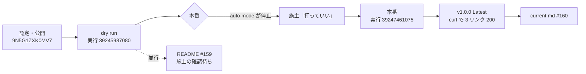

# 日報 2026-10-19 — Store の認定を受けて、GitHub に v1.0.0 を出した。README に Store 版の入れ方を書いた

> 担当: Claude Code（Clockリナ・`/home/xi/docker/NeNeClock`・Opus 5.5）。
> 発端: 1.0.0（Submission 1・#155）が Microsoft Store の認定を通って公開された（施主の申告）。hub の指示書 `_work/handoff-clock-store-approved-2026-10-19-work-order.md`。
> Store: https://apps.microsoft.com/detail/9N5G1ZXK0MV7

---

## 流れ

| 何を | Issue / PR | main |
| --- | --- | --- |
| 実行 39116380259 の成果物を、作り直さずに GitHub の `v1.0.0` に出した（ADR 0022） | — | タグ `v1.0.0` = `53a75e1` |
| `docs/todo/current.md` の「認定の後…v1.0.0 に出す」をチェック済みにした | #160 | `7b0bb8c` |
| README（日英）に Store 版の入れ方と、設定の在りかが入れ方で変わることを書いた | #122 / #159 | **未統合**（施主の確認待ち） |

## v1.0.0 で確かめたこと

- dry run: `.sha256` 5 件（msi・windows zip・linux zip・deb・msix）がすべて `OK`。`would publish v1.0.0 at 53a75e1…`。`dry run: nothing was tagged or published`
- 本番の後: Release は draft でも prerelease でもなく、`releases/latest` は `v1.0.0`。資産は msi・windows-portable.zip・deb とそれぞれの `.sha256` の 6 つ
- README が決め打ちしている `releases/latest/download/` の 3 本（`NeNe-Clock-Setup.msi`・`NeNe-Clock-windows-portable.zip`・`nene-clock_amd64.deb`）は、`curl -I` でいずれも `releases/download/v1.0.0/<同名>` へ転送されて 200

## つまずき

| 何が | どうしたか | 教訓 |
| --- | --- | --- |
| 本番の `gh workflow run … dry_run=false` が auto mode の分類器に止められた（公開面の作成） | 施主に頼み、「打っていい」を受けて打った | 公開を伴う実行は、指示書に GO があっても止まりうる。dry run までを先に済ませ、本番の前で施主に返す |
| #160 を先に統合したら、#159 と `current.md` の隣り合う行がぶつかった | #159 を main へ rebase し、`current.md` は main の版に #122 のチェックだけを載せた | 同じ文書の隣の行を触る PR を 2 本並べると衝突する |
| #160 の squash のコミットの題に `(#122)` が残った（#122 とは無関係） | そのまま | 1 コミットの PR は、コミットの題がそのまま squash の題になる。コミットの題にも正しい番号を書く |
| #122 の README を、前回の引き継ぎ書の「設定の置き場は Store が署名したパッケージで測ってから書く」を見ずに書いた | #159 に注記し、引き継ぎ書に残した。統合は施主の判断 | 着手の前に、直近の引き継ぎ書の該当項目を読む |
